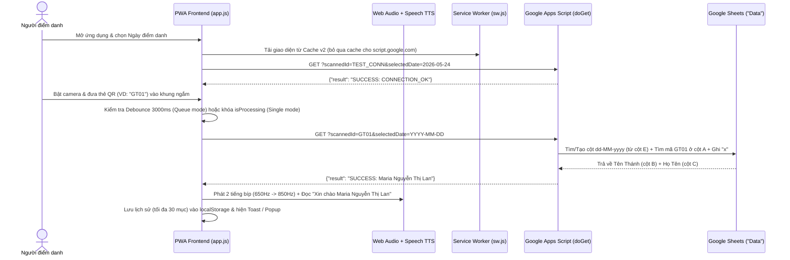

# Tài liệu Mã nguồn Chi tiết — QR Attendance PWA (`DiemDanhQR`)

> **Đường dẫn dự án:** `d:\Project\DiemDanhQR`
> **Kho lưu trữ Git:** `https://github.com/Tthanh2k6/DiemDanhQR.git`
> **Loại ứng dụng:** Progressive Web App (Vanilla HTML/CSS/JS) + Serverless Backend trên Google Apps Script & Google Sheets

---

## 1. Tổng quan Dự án (Project Overview)

### 1.1. Bài toán thực tế & Đối tượng sử dụng
**QR Attendance (`DiemDanhQR`)** là ứng dụng web cài đặt được như ứng dụng di động (PWA) dùng để điểm danh nhanh thành viên bằng mã QR (thiết kế thực tế hướng tới sinh hoạt nhóm/đoàn thể Công giáo như *Bảng điểm danh Giới Trẻ*, có ghép cả **Tên Thánh** và **Họ Tên**).

Thay vì phải thuê VPS hay vận hành cơ sở dữ liệu riêng, hệ thống dùng trực tiếp **Google Sheets** làm nơi lưu trữ & theo dõi báo cáo trực quan, còn **Google Apps Script (GAS Web App)** đóng vai trò cổng API serverless miễn phí. Người phụ trách chỉ cần mở ứng dụng trên điện thoại (qua HTTPS), hướng camera vào thẻ QR của thành viên: ứng dụng tự phát tiếng bíp tổng hợp bằng sóng âm, đọc lời chào tiếng Việt (*"Xin chào Maria Nguyễn Thị Lan"*) và đánh dấu `"x"` vào đúng cột ngày trên Google Sheets theo thời gian thực.

### 1.2. Tech Stack & Thành phần Kỹ thuật

| Tầng | Công nghệ / API | Vai trò cụ thể |
| :--- | :--- | :--- |
| **Frontend UI** | HTML5 + CSS3 Custom Properties ([`index.html`](file:///d:/Project/DiemDanhQR/index.html), [`style.css`](file:///d:/Project/DiemDanhQR/style.css)) | Giao diện chuẩn Mobile-first (`max-width: 430px`), bộ SVG sprite nội tuyến 16 icon, Light/Dark/System theme |
| **Logic & State** | Vanilla JavaScript ES2020 ([`app.js`](file:///d:/Project/DiemDanhQR/app.js)) | Quản lý camera, 2 chế độ quét (hàng đợi liên tục & xác nhận từng người), lưu cấu hình/lịch sử vào `localStorage` |
| **Quét mã QR** | `html5-qrcode` v2.3.8 (CDN `cdnjs`) | Điều khiển luồng video camera, liệt kê ống kính (ưu tiên góc rộng `0.6x`), giải mã QR ở `10 FPS` |
| **Âm thanh & Giọng đọc** | Web Audio API + Web Speech API | Tổng hợp tiếng bíp thành công / buzz báo lỗi không cần file `.mp3`; đọc tên tiếng Việt (`vi-VN`) |
| **PWA & Offline Shell** | Web App Manifest + Service Worker ([`manifest.json`](file:///d:/Project/DiemDanhQR/manifest.json), [`sw.js`](file:///d:/Project/DiemDanhQR/sw.js)) | Cài đặt ra màn hình chính (`standalone`), chiến lược Cache-first (`qr-attendance-cache-v2`) cho tài nguyên tĩnh |
| **Backend Serverless** | Google Apps Script ([`google-apps-script.js`](file:///d:/Project/DiemDanhQR/google-apps-script.js)) | Hàm `doGet(e)` & `processScan()` tìm mã thành viên và tự tạo cột ngày điểm danh trên sheet `Data` |
| **Local Dev Server** | Node.js `http` thuần ([`server.js`](file:///d:/Project/DiemDanhQR/server.js), [`Chay_App.bat`](file:///d:/Project/DiemDanhQR/Chay_App.bat)) | Chạy thử cục bộ tại `http://localhost:8080` không cần `npm install` |

### 1.3. Lịch sử Commit Git Gần nhất
- `30d2af1` — `Redesign UI to match design/QR-Attendance-UI.svg`
- `ab8d411` — `docs: update README`
- `dfe2657` — `Update README.md to reflect new app name and features; enhance installation instructions and clarify usage`
- `622191e` — `Add camera selector in settings modal with auto camera enumeration`
- `655b3a3` — `Move switch camera button outside scanner container to fix visibility`

---

## 2. Kiến trúc Tổng thể & Luồng Dữ liệu (Architecture & Data Flow)

### 2.1. Sơ đồ Tương tác Hệ thống



### 2.2. Hai Chế độ Quét (Dual Scanning Modes)
1. **Chế độ Quét Liên tục — Queue Mode (`state.continuousScan = true`, mặc định)**:
   - Không khóa luồng camera toàn cục; người tiếp theo có thể đưa thẻ vào quét ngay lập tức trong khi request của người trước vẫn đang gửi lên Google Sheets.
   - Chống quét trùng cùng một thẻ bằng bảng băm `state.recentScans` (`Map<qrCode, timestamp>`) với ngưỡng `SCAN_DEBOUNCE_MS = 3000` ms (3 giây) riêng cho từng mã.
   - Hiển thị bộ đếm số request đang bay trên không trung qua `state.pendingCount` (`#pendingIndicator`) và thông báo nổi `.scan-toast` ngay đáy khung camera (tự ẩn sau `2 giây` nếu thành công; giữ nguyên trên màn hình nếu lỗi để người trực kịp nhìn thấy).
2. **Chế độ Từng người — Single Mode (`state.continuousScan = false`)**:
   - Đặt cờ khóa `state.isProcessing = true` ngay khi bắt được mã, ẩn tia laser và trượt thẻ kết quả toàn khung `.result-popup` từ dưới lên (`loading` → `success` hoặc `error`).
   - Camera giữ nguyên kết quả cho đến khi người dùng chủ động bấm **"Xác nhận & quét tiếp"** (hoặc **"Quét lại"** / **"Bỏ qua"** khi lỗi), sau đó đợi thêm `600ms` mới mở khóa `state.isProcessing = false` để tránh bắt dính lại mã cũ còn trước ống kính.

---

## 3. Cấu trúc Thư mục & Bản đồ Toàn bộ Tệp nguồn (Complete File Map)

```text
DiemDanhQR/
├── index.html              # Khung giao diện chính, SVG icon symbols, scanner, lịch sử và bottom-sheet cài đặt
├── style.css               # Hệ thống thiết kế CSS Variables (Light/Dark), hiệu ứng laser, toast, popup, bottom-sheet
├── app.js                  # Toàn bộ logic trạng thái, camera, âm thanh Web Audio, giọng đọc TTS và gọi API GAS
├── sw.js                   # Service Worker PWA cache tài nguyên tĩnh (qr-attendance-cache-v2)
├── manifest.json           # Cấu hình cài đặt PWA (tên app, màu nền #F3F4F1, hướng dọc portrait, icons)
├── google-apps-script.js   # Mã nguồn backend cần copy/deploy lên Google Apps Script của bảng tính
├── server.js               # Máy chủ HTTP tĩnh Node.js cổng 8080 phục vụ chạy thử cục bộ
├── Chay_App.bat            # Script Windows mở trình duyệt http://localhost:8080 và chạy node server.js
├── README.md               # Tài liệu giới thiệu dự án, cấu trúc bảng tính Data và hướng dẫn thiết lập
├── Huong_dan_Hosting.md    # Hướng dẫn chi tiết triển khai HTTPS miễn phí lên Netlify Drop & GitHub Pages
├── CODEBASE.md             # Tài liệu kiến trúc & chi tiết mã nguồn toàn diện (file này)
└── agent.md                # Hướng dẫn quy trình đọc-hiểu và cập nhật tài liệu cho AI Agent
```

| Tệp nguồn | Số dòng | Vai trò & Thành phần chính |
| :--- | :---: | :--- |
| [`index.html`](file:///d:/Project/DiemDanhQR/index.html) | 257 | Định nghĩa 16 `<symbol>` SVG, script chống nháy theme sớm trong `<head>`, bố cục `.app` và `#settingsModal` |
| [`style.css`](file:///d:/Project/DiemDanhQR/style.css) | 1.023 | Bộ token màu `:root` & `[data-theme="dark"]`, trạng thái `body.scanning`, `@keyframes` (`scan-move`, `scaleUp`, `shake`) |
| [`app.js`](file:///d:/Project/DiemDanhQR/app.js) | 998 | Đối tượng `state`, bản đồ `DOM`, `playAudioAlert()`, `speakVietnamese()`, quản lý `Html5Qrcode`, `performAttendance()` |
| [`google-apps-script.js`](file:///d:/Project/DiemDanhQR/google-apps-script.js) | 122 | Hàm `doGet(e)` xử lý CORS JSON & `TEST_CONN`, hàm `processScan(scannedId, selectedDate)` thao tác trên Google Sheet `Data` |
| [`sw.js`](file:///d:/Project/DiemDanhQR/sw.js) | 61 | Vòng đời `install` / `activate` / `fetch` của Service Worker, ngoại trừ domain `script.google.com` |
| [`server.js`](file:///d:/Project/DiemDanhQR/server.js) | 54 | HTTP server cổng `8080`, hỗ trợ 7 MIME types, tắt cache trình duyệt (`no-store`) khi phát triển cục bộ |
| [`manifest.json`](file:///d:/Project/DiemDanhQR/manifest.json) | 24 | Metadata PWA (`QR Attendance Pro`, `display: standalone`, `orientation: portrait`) |
| [`Chay_App.bat`](file:///d:/Project/DiemDanhQR/Chay_App.bat) | 14 | Launcher tiện lợi cho người dùng Windows không quen dòng lệnh |
| [`README.md`](file:///d:/Project/DiemDanhQR/README.md) | 91 | Tài liệu tổng quan & quy chuẩn cột của Sheet `Data` |
| [`Huong_dan_Hosting.md`](file:///d:/Project/DiemDanhQR/Huong_dan_Hosting.md) | 59 | Cẩm nang đưa frontend lên Netlify Drop / GitHub Pages để có HTTPS mở camera trên điện thoại |

---

## 4. Phân tích Chi tiết Từng Tệp Mã nguồn (Deep-Dive Source Reference)

### 4.1. [`app.js`](file:///d:/Project/DiemDanhQR/app.js#L1-L998) — Logic Điều phối Frontend

#### A. Quản lý Trạng thái (`state`, dòng 7–27) & Khởi tạo (`initApp`, dòng 210–240)
- Giữ toàn bộ trạng thái runtime trong một object phẳng `state`: cấu hình đọc từ `localStorage`, đối tượng `html5QrCode`, danh sách `cameras`, `recentScans` (`Map`), bộ đếm `pendingCount` và `sessionPresent` (số người có mặt tính riêng trong phiên mở trang hiện tại).
- Khi `DOMContentLoaded`: gọi `initApp()` (áp theme, tự động gọi `refreshConnection()` nếu đã có `gasUrl`, gán mặc định ô ngày bằng ngày hôm nay của máy khách `YYYY-MM-DD`, vẽ lại lịch sử) → `registerEvents()` → đăng ký `navigator.serviceWorker.register('sw.js')`.

#### B. Tổng hợp Âm thanh Không cần File (`playAudioAlert`, dòng 108–156)
- Sử dụng `AudioContext` (tự động `resume()` nếu bị trình duyệt treo ở trạng thái `'suspended'`):
  - **Thành công (`isSuccess = true`)**: Tạo sóng hình sin (`'sine'`) âm lượng `0.08` với 2 nốt cao nối tiếp — nốt 1 ở `650 Hz` dài `80ms`, cách `100ms` phát nốt 2 ở `850 Hz` dài `120ms` (*Happy Chirp*).
  - **Thất bại (`isSuccess = false`)**: Tạo sóng răng cưa (`'sawtooth'`) âm lượng `0.12` ở tần số trầm `130 Hz` kéo dài `400ms` (*Buzz Error*).

#### C. Đọc Tên Tiếng Việt (`speakVietnamese`, dòng 168–195)
- Dùng `window.speechSynthesis`: gọi `.cancel()` ngắt câu cũ đang đọc dở (rất quan trọng khi quét liên tục nhiều người), cấu hình `lang = 'vi-VN'`, `rate = 0.95`, `pitch = 1.05`, tự dò tìm giọng đọc trong `voiceList` có mã ngôn ngữ chứa `vi` hoặc tên chứa `vietnam`.

#### D. Kiểm tra Kết nối Google Sheets (`checkConnection`, dòng 498–521)
- Bắn request `GET ${url}?scannedId=TEST_CONN&selectedDate=2026-05-24` kèm `AbortController` timeout `8000ms`.
- Chỉ coi là hợp lệ (`status: 'ok'`) khi JSON trả về chứa chuỗi `'CONNECTION_OK'`. Nếu GAS trả về kết quả khác (ví dụ bản mã GAS cũ chưa có nhánh bắt `TEST_CONN`), ứng dụng cảnh báo rõ: *"GAS cũ – hãy cập nhật & Redeploy Apps Script"*.

#### E. Chọn Ống kính Thông minh & Vòng đời Camera (Dòng 448–687)
- **`loadCameraOptions()` & `startScanning()`**:
  - Nếu người dùng đã lưu `state.selectedCameraId` trong Cài đặt → mở đúng camera đó.
  - Nếu để *"Tự động"*: gọi `Html5Qrcode.getCameras()`, ưu tiên tìm ống kính góc siêu rộng khớp regex `/wide|ultra|0\.6/i` (giúp quét thẻ QR ở khoảng cách gần dễ hơn nhiều so với ống kính tele/chính), nếu không có thì lọc danh sách camera sau (`!/front|user|facing front/i`) và ưu tiên `rear[1]` (trên nhiều máy Android cụm nhiều cam, `rear[1]` thường là cam góc rộng) rồi mới tới `rear[0]`.
  - **Cơ chế tự phục hồi (`onFailed`, dòng 610–623)**: Nếu mở theo `cameraId` bị lỗi (ví dụ đổi thiết bị hoặc trình duyệt đổi ID), tự động thử lại lần 2 với `{ facingMode: "environment" }` trước khi báo lỗi cho người dùng.
- **`switchCamera()` (dòng 659–687)**: Dừng phiên quét hiện tại và xoay vòng sang camera kế tiếp `(currentIdx + 1) % cameras.length`.

#### F. Xử lý Điểm danh & Phân loại Lỗi (`describeError`, `performAttendance`, dòng 718–895)
- `describeError(message)` dịch các chuỗi lỗi kỹ thuật từ GAS sang thông báo thân thiện kèm hướng dẫn xử lý:
  - `/Không tìm thấy ID/i` → *"Không tìm thấy mã"* (nhắc kiểm tra thẻ hoặc thêm dòng vào sheet `Data`).
  - `/Không tìm thấy sheet/i` → *"Thiếu sheet “Data”"*.
  - `/kết nối|Internet|CORS|mạng/i` → *"Lỗi kết nối"*.
- `addHistoryItem()` & `renderHistory()` (dòng 942–998): Tạo avatar chữ cái đầu từ **2 từ cuối của tên** (`getInitials("Maria Nguyễn Thị Lan")` → `"TL"`), giữ tối đa `30` bản ghi mới nhất trong `localStorage`, chống XSS bằng `escapeHtml()`.

---

### 4.2. [`google-apps-script.js`](file:///d:/Project/DiemDanhQR/google-apps-script.js#L1-L122) — Backend trên Google Sheets

- **`doGet(e)` (dòng 19–52)**:
  - Nhánh 1: Nếu có `e.parameter.scannedId`:
    - Nếu `scannedId === "TEST_CONN"` → trả ngay JSON `{"result": "SUCCESS: CONNECTION_OK"}` mà **không chạm vào bảng tính**.
    - Ngược lại → gọi `processScan(scannedId, selectedDate)` và trả về `ContentService.createTextOutput(JSON.stringify({ result })).setMimeType(ContentService.MimeType.JSON)`.
  - Nhánh 2: Nếu mở URL trực tiếp trên trình duyệt không kèm tham số → thử render template `Index` (tương thích ngược bản cũ) hoặc hiện thông báo HTML xác nhận Web App đang hoạt động.
- **`processScan(scannedId, selectedDate)` (dòng 59–122)**:
  1. Mở bảng tính đang gắn script (`SpreadsheetApp.getActiveSpreadsheet()`) và tìm đúng sheet tên `"Data"`.
  2. Chuyển chuỗi `selectedDate` (`YYYY-MM-DD`) sang chuỗi định dạng Việt Nam `dd-MM-yyyy` theo múi giờ của Script (`Session.getScriptTimeZone()`).
  3. Quét hàng tiêu đề `headers` bắt đầu từ **chỉ số `4` (tức Cột E)** sang phải để tìm cột trùng ngày `dd-MM-yyyy` (xử lý cả trường hợp Google Sheets tự ép kiểu ô tiêu đề thành đối tượng `Date` lẫn chuỗi thuần).
  4. Nếu chưa có cột ngày đó (`colIndex === -1`): tự chèn cột mới ngay sau cột cuối cùng, tô nền tiêu đề `#e2e2e2` in đậm căn giữa, kẻ viền đen `SOLID` từ hàng 1 tới `lastRow` và `autoResizeColumn`.
  5. Duyệt từ hàng thứ 2 (`j = 1`) so sánh `data[j][0].toString().trim() === scannedId`: nếu khớp thì ghi `"x"` căn giữa vào ô `(j + 1, colIndex + 1)`, ghép `tenThanh` (Cột B) + `hoTen` (Cột C) trả về `"SUCCESS: " + fullName`.

---

### 4.3. [`sw.js`](file:///d:/Project/DiemDanhQR/sw.js#L1-L61) & [`server.js`](file:///d:/Project/DiemDanhQR/server.js#L1-L54)
- **`sw.js`**: Pre-cache 7 URL trong `ASSETS_TO_CACHE` (bao gồm cả thư viện `html5-qrcode.min.js` trên `cdnjs` và icon Flaticon). Ở sự kiện `fetch`, nếu URL chứa `'script.google.com'` hoặc `'googleusercontent.com'` (domain redirect khi GAS trả JSON) thì `return` ngay để trình duyệt luôn gọi mạng trực tiếp, tuyệt đối không cache kết quả điểm danh!
- **`server.js`**: Máy chủ tĩnh mỏng dùng cho môi trường dev trên máy tính (`http://localhost:8080` là secure context hợp lệ để Chrome trên PC cho phép bật webcam).

---

## 5. Mô hình Dữ liệu, Lưu trữ & Giao thức API (Schemas & API Contract)

### 5.1. Cấu trúc Bắt buộc của Google Sheet `"Data"`

| Cột | Chỉ số mảng (`0-based`) | Nội dung quy ước | Ví dụ |
| :---: | :---: | :--- | :--- |
| **A** | `0` | **Mã thành viên** (khớp chính xác nội dung mã QR) | `GT01` |
| **B** | `1` | **Tên Thánh / Tên đệm phụ** (có thể để trống) | `Maria` |
| **C** | `2` | **Họ và Tên** | `Nguyễn Thị Lan` |
| **D** | `3` | Cột thông tin dự phòng (bắt buộc giữ chỗ để ngày bắt đầu từ cột E) | *(SĐT / Ghi chú)* |
| **E trở đi** | `4+` | Các cột ngày điểm danh định dạng `dd-MM-yyyy`; ô có mặt ghi `"x"` | `26-10-2026` → `x` |

### 5.2. Các Khóa `localStorage` trên Trình duyệt

| Khóa (`localStorage`) | Kiểu lưu trữ | Giá trị mặc định | Mô tả |
| :--- | :--- | :--- | :--- |
| `qr_attendance_gas_url` | `string` | `""` | URL triển khai Google Apps Script kết thúc bằng `/exec` |
| `qr_attendance_camera_id` | `string` | `""` | Device ID của camera đã chọn (`""` = tự động ưu tiên góc rộng) |
| `qr_attendance_history` | `JSON string` | `"[]"` | Mảng tối đa 30 phần tử `{ id, name, date, time, success, note }` |
| `qr_attendance_theme` | `string` | `"light"` | Chế độ màu: `"light"`, `"dark"`, hoặc `"system"` |
| `qr_attendance_continuous` | `string` | `"true"` | `"true"` = Quét liên tục (Queue), `"false"` = Từng người (Single) |
| `qr_attendance_voice` | `string` | `"true"` | `"true"` = Bật đọc tên tiếng Việt qua Web Speech API |

### 5.3. Hợp đồng API (Frontend ⇄ Google Apps Script)
- **Endpoint:** `<GAS_WEB_APP_URL>` (HTTP `GET`, tự theo dõi HTTP 302 redirect của Google sang `script.googleusercontent.com`).
- **Query Params:**
  - `scannedId` *(bắt buộc)*: Mã quét được từ QR, hoặc chuỗi đặc biệt `"TEST_CONN"`.
  - `selectedDate` *(bắt buộc khi điểm danh)*: Ngày dạng `YYYY-MM-DD` (ví dụ `2026-10-26`).
- **Response JSON (`200 OK`):**
  - Ping kết nối: `{ "result": "SUCCESS: CONNECTION_OK" }`
  - Điểm danh thành công: `{ "result": "SUCCESS: Maria Nguyễn Thị Lan" }`
  - Điểm danh lỗi: `{ "result": "ERROR: Không tìm thấy ID GT99" }` hoặc `{ "result": "ERROR: Không tìm thấy sheet 'Data'!" }`

---

## 6. Giao diện Người dùng & Hệ thống Thiết kế (`index.html` & `style.css`)

- **Ngôn ngữ thiết kế:** Dựng khớp bản vẽ `design/QR-Attendance-UI.svg`, font chữ `Be Vietnam Pro`, bố cục cột đơn tối đa `430px` căn giữa màn hình, tính toán cả vùng tai thỏ/thanh điều hướng iOS (`env(safe-area-inset-bottom)`).
- **Chuyển đổi Bố cục Động khi Quét (`body.scanning`)**:
  - Khi camera tắt: hiện thẻ chọn ngày đầy đủ `.date-card`, khung ngắm vuông gọn `aspect-ratio: 350 / 320`.
  - Khi camera bật (`body.scanning`): thu gọn ngày thành dải `.date-strip` (chip ngày + bộ đếm `"Phiên này: N có mặt"`), mở rộng khung camera lên `aspect-ratio: 350 / 480`, đổi viền góc ngắm sang xanh ngọc `--live: #3DDC97` và chạy vạch tia laser `@keyframes scan-move`.
- **Xem thử Theme Tức thì trong Cài đặt (`state.pendingTheme`)**: Khi mở Bottom Sheet *Cài đặt* và bấm thử Sáng / Tối / Theo máy, giao diện đổi màu ngay nhưng chỉ ghi vào `localStorage` khi bấm **Lưu cài đặt**; nếu bấm **Hủy** hoặc bấm ra ngoài nền mờ sẽ tự trả lại theme cũ.

---

## 7. Hướng dẫn Chạy Cục bộ & Triển khai Thực tế (Setup & Deployment)

### 7.1. Chạy thử trên Máy tính (Localhost)
```powershell
cd d:\Project\DiemDanhQR
node server.js
# Mở trình duyệt tại: http://localhost:8080
```
Hoặc nhấp đúp [`Chay_App.bat`](file:///d:/Project/DiemDanhQR/Chay_App.bat) trên Windows.

### 7.2. Triển khai Thực tế để Quét bằng Điện thoại (Bắt buộc HTTPS)
- Trình duyệt di động (Chrome Android / Safari iOS) **chặn quyền Camera (`getUserMedia`) trên kết nối HTTP thường** (trừ `localhost`). Vì vậy để dùng trên điện thoại, chỉ cần tải 5 tệp tĩnh (`index.html`, `style.css`, `app.js`, `manifest.json`, `sw.js`) lên **Netlify Drop** hoặc **GitHub Pages** theo [`Huong_dan_Hosting.md`](file:///d:/Project/DiemDanhQR/Huong_dan_Hosting.md).
- Về phía Google Sheets: mỗi khi sửa [`google-apps-script.js`](file:///d:/Project/DiemDanhQR/google-apps-script.js), phải vào **Apps Script → Triển khai → Quản lý các bản triển khai → Chỉnh sửa (biểu tượng bút chì) → Phiên bản mới (New version) → Triển khai** (nếu chỉ bấm nút Lưu ổ đĩa trong Apps Script thì URL `/exec` vẫn chạy code phiên bản cũ!).

---

## 8. Quy ước, Bất biến Kỹ thuật & Các Điểm Dễ Lỗi (Invariants & Gotchas)

1. **Bất biến 4 cột đầu của Sheet `Data` (`A` đến `D`):**
   - `processScan()` luôn bắt đầu dò cột ngày từ `i = 4` (Cột E). Nếu xóa bớt cột `D` trên Google Sheet khiến ngày điểm danh dồn sang cột `D`, script sẽ không nhìn thấy cột đó và tạo cột trùng ở cuối bảng!
2. **Bất biến Service Worker bỏ qua Domain của Google (`sw.js` dòng 46):**
   - Khi gọi URL `script.google.com/macros/s/.../exec`, Google trả về HTTP `302` chuyển hướng sang `script.googleusercontent.com`. Cả hai tên miền này **bắt buộc phải được bỏ qua trong `sw.js`**; nếu bị cache, mọi lần quét sau sẽ nhận kết quả giả từ bộ nhớ đệm mà không ghi lên Sheet!
3. **Đổi phiên bản Cache khi sửa Frontend (`CACHE_NAME` trong `sw.js`):**
   - Chiến lược trong `sw.js` là **Cache-first** cho `index.html`, `style.css`, `app.js`. Do đó mỗi khi sửa 1 trong 3 file này để deploy bản mới lên hosting, **bắt buộc phải tăng số phiên bản `CACHE_NAME`** (ví dụ từ `'qr-attendance-cache-v2'` lên `'qr-attendance-cache-v3'`), nếu không điện thoại của người dùng đã cài PWA sẽ tiếp tục chạy giao diện/logic cũ từ cache!
4. **Lưu ý về Múi giờ Ngày Điểm danh trên GAS (`new Date("YYYY-MM-DD")`):**
   - Trong `google-apps-script.js` dòng 70, `new Date("2026-10-26")` được hiểu là `2026-10-26T00:00:00Z` (UTC). Tại Việt Nam (`GMT+7`), `00:00 UTC` là `07:00 sáng` cùng ngày nên `Utilities.formatDate` luôn ra đúng ngày `26-10-2026`. Tuy nhiên nếu tài khoản Google cấu hình múi giờ dự án Apps Script ở châu Mỹ (`UTC-5`..`UTC-8`), ngày sẽ bị lùi 1 hôm! Hãy đảm bảo *Project Settings* của Apps Script đặt múi giờ `(GMT+07:00) Ho Chi Minh`.
5. **Xử lý Đụng độ Ghi Đồng thời (Concurrent Scans) ở Chế độ Quét Liên tục:**
   - Khi quét liên tục nhiều thẻ trong ngày mới chưa có cột ngày trên Sheet, nếu 2 request đầu tiên bay lên GAS cùng một tích tắc trước khi cột ngày kịp tạo, có thể sinh ra 2 cột trùng ngày nếu chưa dùng `LockService`. Với quy mô nhóm nhỏ quét qua 1 điện thoại (cách nhau vài trăm ms–1s) hiện chạy ổn, nhưng nếu dùng nhiều máy quét song song cùng lúc thì nên bọc `LockService.getScriptLock()` quanh `processScan()`.
6. **Phạm vi sử dụng của `server.js`:**
   - `server.js` ghép đường dẫn trực tiếp `'.' + req.url.split('?')[0]` không chặn `..`, và không có TLS. Chỉ dùng để chạy thử trên máy cá nhân tin cậy, tuyệt đối không mở port `8080` của `server.js` ra Internet công cộng.

---

## 9. Nhật ký Cập nhật Tài liệu (Documentation Changelog)

| Ngày | Người / Agent thực hiện | Nội dung cập nhật |
| :--- | :--- | :--- |
| 2026-10-26 | Antigravity Agent | Khởi tạo tài liệu `CODEBASE.md` chi tiết toàn diện sau khi đọc 100% toàn bộ 10 tệp của dự án. |
