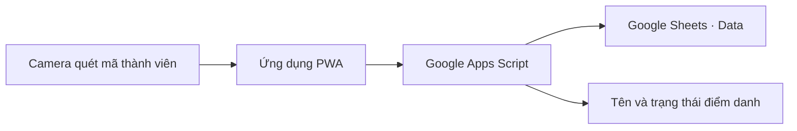

# QR Attendance

**Quét một mã. Ghi nhận một người. Theo dõi ngay trên Google Sheets.**


Ứng dụng web điểm danh cho nhóm nhỏ: quét QR bằng camera, hiển thị tên và lưu kết quả theo ngày vào Google Sheets. Frontend là HTML/CSS/JavaScript; Google Apps Script tiếp nhận yêu cầu ghi dữ liệu nên không cần tự vận hành backend riêng.

[Tính năng](#tính-năng) · [Thiết lập](#thiết-lập) · [Chạy cục bộ](#chạy-cục-bộ) · [Cấu trúc](#cấu-trúc)

## Tính năng

- Quét liên tục hoặc quét từng người có xác nhận.
- Chọn camera, hiển thị lịch sử quét, phát âm thanh và đọc tên tiếng Việt.
- Chọn ngày điểm danh; lưu kết quả vào cột tương ứng trong bảng tính.
- Giao diện sáng/tối và hỗ trợ thêm ứng dụng vào màn hình chính dưới dạng PWA.



## Thiết lập

### 1. Chuẩn bị bảng tính

Tạo sheet có tên chính xác là **`Data`**, với hàng đầu là tiêu đề:

| Cột | Nội dung mà script sử dụng |
| --- | --- |
| A | Mã thành viên, trùng nội dung mã QR, ví dụ `GT01` |
| B | Tên thánh hoặc phần tên bổ sung; có thể để trống |
| C | Họ tên |
| D | Cột thông tin dự phòng |
| E trở đi | Các ngày điểm danh theo định dạng `dd-MM-yyyy` |

Giữ đủ bốn cột đầu trong hàng tiêu đề. Khi chưa có ngày cần điểm danh, script thêm cột ở cuối bảng và ghi `x` vào dòng của mã thành viên tìm được.

### 2. Triển khai Apps Script

1. Trong bảng tính, mở **Tiện ích mở rộng → Apps Script**.
2. Dán mã từ [`google-apps-script.js`](google-apps-script.js), lưu dự án.
3. Chọn **Triển khai mới → Ứng dụng web**.
4. Đặt thực thi dưới tài khoản của bạn, quyền truy cập **Mọi người** để frontend gọi trực tiếp.
5. Cấp quyền và sao chép URL kết thúc bằng `/exec`.

Endpoint hiện không có lớp đăng nhập riêng cho người quét. Hãy quản lý URL triển khai và quyền chia sẻ bảng tính theo phạm vi nhóm sử dụng.

### 3. Kết nối frontend

Mở ứng dụng → **Cài đặt** → dán **Google Apps Script URL** → lưu và kiểm tra kết nối. Bật camera lần đầu để cấp quyền; sau đó có thể chọn ống kính trong phần cài đặt.

## Chạy cục bộ

Cần Node.js; server chỉ dùng thư viện có sẵn, không cần `npm install`.

```powershell
git clone https://github.com/Tthanh2k6/DiemDanhQR.git
cd DiemDanhQR
node server.js
```

Mở **http://localhost:8080** trên máy đang chạy server. Trên Windows có thể dùng `Chay_App.bat` để khởi động và mở trình duyệt.

Để dùng camera trên điện thoại qua mạng, triển khai frontend qua **HTTPS**. Địa chỉ HTTP dạng IP nội bộ không tương đương `localhost` trên thiết bị và có thể bị trình duyệt chặn camera. Xem thêm [`Huong_dan_Hosting.md`](Huong_dan_Hosting.md).

## Dùng như ứng dụng điện thoại

- **Android/Chrome:** menu trình duyệt → Thêm vào màn hình chính.
- **iOS/Safari:** Chia sẻ → Thêm vào màn hình chính.

Khả năng cài PWA và đọc tên phụ thuộc trình duyệt. Việc ghi điểm danh vào Google Sheets vẫn cần kết nối mạng.

## Cấu trúc

| File | Vai trò |
| --- | --- |
| [`index.html`](index.html), [`style.css`](style.css) | Giao diện |
| [`app.js`](app.js) | Camera, xử lý kết quả, cài đặt và gọi endpoint |
| [`google-apps-script.js`](google-apps-script.js) | Tìm thành viên và ghi bảng điểm danh |
| [`manifest.json`](manifest.json), [`sw.js`](sw.js) | Cấu hình PWA và service worker |
| [`server.js`](server.js) | Server tĩnh để chạy thử cục bộ |

---

**Trần Trung Thành** · [@Tthanh2k6](https://github.com/Tthanh2k6)
