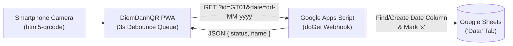

# Serverless QR Attendance Check-In PWA (`DiemDanhQR`)

<div align="center">
  <a href="https://tthanh2k6.github.io/DiemDanhQR/">
    
  </a>

  <br />

  <p align="center">
    <a href="https://tthanh2k6.github.io/DiemDanhQR/">
      
    </a>
  </p>

  <p align="center">
    
    
    
    
  </p>
</div>

---

## ⚡ Overview

**DiemDanhQR** is a zero-server-cost mobile Progressive Web App (PWA) that scans member QR codes via smartphone camera and logs attendance directly into **Google Sheets** in real time through a **Google Apps Script (`doGet`)** webhook backend.

### Key Engineering Features
- **Continuous Queue Scanning Mode (`~25 people/min`):** Keeps the camera stream running continuously without blocking on network latency. Uses a `3,000ms` per-ID debounce map (`recentScans`) so operators can scan a line of attendees rapidly while Google Apps Script requests resolve asynchronously in the background.
- **Automated Google Sheets Schema Management:** The Apps Script endpoint ([`google-apps-script.js`](google-apps-script.js)) automatically locates or creates the `dd-MM-yyyy` date column on the **`Data`** sheet, marks `"x"` on the matching member row, and returns the member's full name as JSON.
- **Field-Tested Mobile UX:**
  - **Multi-Lens Camera Selector:** Enumerates physical camera lenses (including `0.6x` ultra-wide lenses on modern phones for close-range focus).
  - **Synthesized Web Audio & Voice Greeting:** Generates crisp success/error tones via **Web Audio API** (zero external MP3 assets) and reads the attendee's name aloud via **Web Speech API (`speechSynthesis`)**.
  - **Installable PWA:** Includes `manifest.json` and `sw.js` Service Worker for home-screen installation on Android & iOS.



---

## 🛠️ Setup Guide (Google Sheets + Apps Script)

### 1. Prepare the Google Sheet
Create a Google Sheet with a tab named **`Data`** and the following header columns in Row 1:

| Column | Purpose |
| :--- | :--- |
| **A** | **Member ID** (matches QR code payload, e.g., `GT01`) |
| **B** | Title / Middle Prefix *(optional)* |
| **C** | **Full Name** |
| **D** | Notes / Reserved |
| **E+** | Attendance date columns (`dd-MM-yyyy`) — **automatically created by the script** when scanning |

### 2. Deploy the Google Apps Script Webhook
1. In your Google Sheet, click **Extensions → Apps Script**.
2. Paste the contents of [`google-apps-script.js`](google-apps-script.js) and save.
3. Click **Deploy → New deployment → Web app**:
   - **Execute as:** *Me*
   - **Who has access:** *Anyone*
4. Copy the generated Web App URL ending in `/exec`.
5. Open the PWA ([Live Demo](https://tthanh2k6.github.io/DiemDanhQR/)) → **Settings (Cài đặt)** → paste the `/exec` URL and click **Save**.

---

## 💻 Run Locally

Requires Node.js (uses zero external npm packages; `server.js` runs on Node's built-in `http` module):

```powershell
git clone https://github.com/Tthanh2k6/DiemDanhQR.git
cd DiemDanhQR
node server.js
```

Open **`http://localhost:8080`** in your browser (or double-click `Chay_App.bat` on Windows).

---

## 📂 Repository Structure

| File | Role |
| :--- | :--- |
| [`index.html`](index.html), [`style.css`](style.css) | Responsive mobile UI with light/dark theme support |
| [`app.js`](app.js) | Camera controller, 3s debounce queue, Web Audio synthesizer, TTS & webhook client |
| [`google-apps-script.js`](google-apps-script.js) | Serverless Google Apps Script (`doGet`) backend for Google Sheets |
| [`manifest.json`](manifest.json), [`sw.js`](sw.js) | PWA manifest and offline Service Worker shell |
| [`server.js`](server.js) | Zero-dependency local static HTTP development server |

---

**Author:** **Trung Thanh Tran** (*Trần Trung Thành*) · [GitHub `@Tthanh2k6`](https://github.com/Tthanh2k6) · [Upwork Profile](https://www.upwork.com/freelancers/~01ee7c2348cb4b62fe)
